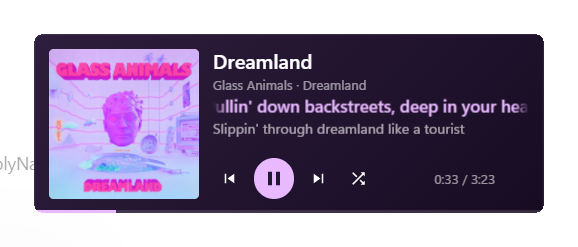

# MaterialFloatPlayer

网易云音乐 BetterNCM 插件：一个类似桌面歌词的独立悬浮播放器，Material 3 风格。



## 功能

- 独立窗口、始终置顶、不被主窗口遮挡，可像桌面歌词一样摆在桌面上任意位置
  - **全屏游戏上方显示**：窗口化 / 无边框 / 开了「全屏优化」的游戏都能盖在上面（独占全屏除外，见下）
- 圆角方形专辑封面（跟随窗口高度自适应）
- 控制按钮：上一首 / 播放暂停 / 下一首 / 切换播放模式（列表循环、单曲循环、随机播放、顺序播放、心动模式）
  - 播放中显示两条竖杠（点它暂停），暂停中显示三角（点它播放），鼠标悬停也会说明"点击后会做什么"
  - **沉浸模式**：关掉这些按钮，只留封面、歌名、歌词和时间
- 滚动歌词：显示当前行 + 副行（翻译或下一句），带淡入上移切换动画
  - 单句歌词太长时，会按这句歌词的时长横向滚动一遍，两侧渐隐
  - 只有真正在滚动时才做两侧渐隐，停止滚动后立刻恢复正常显示
  - 副行文字的透明度作用在文字本身，切换歌词时会直接以淡色出现，不会再先闪一下白色
  - 歌词翻译可开关（打开时副行显示翻译，关闭时显示下一句）
- 歌名过长时先显示开头部分，之后大约每 10 秒整段单向滚一次，滚完停一下直接回到开头（不倒着滚回来，同样只在滚动时渐隐）
- 进度条与播放时间：进度条贴在底边上，两端跟着卡片圆角收进去（不会被圆角切出一道斜口）
- 背景颜色可选：
  - **专辑主要颜色**：按 Material You（Monet/HCT）的思路取色 —— 先把封面像素转到
    感知均匀的 OkLab/OkLCh 空间，拆开「色相 / 彩度 / 明度」，按色相聚类后选"占比高且够鲜艳"的
    那一族作为源色，再按目标明度生成背景与强调色（同一色相明暗变化时的观感更接近原图）
  - **自定义颜色**：自己挑一个颜色
- **白天模式**：同一套取色换成浅色背景（浅底 + 深字，描边和进度条槽改成黑色系），需要浅色桌面时用
- 切歌换色时背景是交叉淡入过渡（约 0.65 秒），播放按钮、进度条、歌词高亮色等控件颜色也一起平滑过渡
- 背景不透明度、播放器宽度、歌词字号可调
- 窗口位置会被记住，重启后恢复
- 运行日志写到 `C:\betterncm\MaterialFloatPlayer.log`，方便排查问题

## 安装

插件已打包为 `.plugin` 文件，直接放到网易云的 BetterNCM 插件目录即可：

```
C:\betterncm\plugins\MaterialFloatPlayer-1.0.0.plugin
```

重启网易云音乐后生效（BetterNCM 会把它解压到 `C:\betterncm\plugins_runtime\MaterialFloatPlayer`）。
在 BetterNCM 插件管理器里可以打开本插件的设置页面。

## 设置项

| 设置 | 说明 |
| --- | --- |
| 启用悬浮播放器 | 关掉后悬浮窗会关闭，插件不再自动打开 |
| 背景颜色 | 专辑主要颜色 / 自定义颜色（右侧取色器） |
| 白天模式（浅色背景） | 同一套取色改成浅色方案：浅底深字，描边 / 悬停底色 / 进度条槽用黑色系 |
| 沉浸模式（隐藏播放按钮） | 不显示上一首 / 播放暂停 / 下一首 / 顺序播放这几个按钮，只留封面、歌词和时间 |
| 播放器宽度 | 260 – 720，窗口高度按比例自适应 |
| 圆角半径 | 0 – 32（0 就是直角），同时作用于窗口外轮廓圆角与封面圆角 |
| 歌词字号 | 10 – 20 |
| 不透明度 | 0.4 – 1 |
| 显示歌词翻译 | 打开后当前行会带上翻译 |
| 显示播放时间 | 是否显示 "1:23 / 3:18" |
| 窗口置顶 | 是否把窗口设为置顶 |
| 全屏游戏上方显示 | 只在"前台真的是一个铺满显示器的窗口"时才把悬浮窗重新提到置顶档最前面（不抢焦点、不轮询） |
| 显示阴影 | 阴影开关。开 = 网易云自带的窗口阴影，会被裁成贴合圆角的环；关 = 完全无阴影 |

按钮：打开悬浮窗、关闭悬浮窗、重新加载悬浮窗、重置窗口位置。

## 操作

- 拖动卡片任意空白处（避开按钮）即可移动窗口，位置会自动保存
- 点击 ✕ 关闭本次运行的悬浮窗，下次启动网易云会重新打开
- 双击？没有，所有功能都在按钮上（悬停有中文提示）

## 依赖（可选）

歌词显示依赖下面任一插件提供的数据源，未安装时播放器仍可正常使用，只是不显示歌词：

- `liblyric`（推荐，支持翻译/逐字歌词对齐）
- `LibEAPIRequest`（插件会自己解析 LRC 与翻译）

## 实现说明

- 悬浮窗通过网易云原生的 `winhelper.launchWindow` 创建（与桌面歌词、迷你播放器同一套机制），
  页面内容由 BetterNCM 的 `hijacks` 机制注入，因此窗口是真正的独立窗口，不依赖主窗口。
- 悬浮窗与主窗口同源（`orpheus://orpheus`），二者通过 `localStorage` 交换播放状态与控制命令。
- 播放控制优先点击网易云播放栏自身的按钮（`#main-player .btnp-play` / `.btnc-prv` / `.btnc-nxt` / `.type`），
  保证与客户端行为完全一致；播放暂停在找不到按钮时会退回 `audioplayer.play/pause` 原生调用。
  播放状态则用「播放进度是否在走动」来判断（网易云内部的 playing.state 有时和实际不一致），
  自己点播放/暂停后会先本地翻转一次，界面立刻有反馈。
- 窗口尺寸与位置：`winhelper` 的接口使用物理像素，而页面坐标是逻辑像素，
  插件会按 `devicePixelRatio` 换算并用"申请值/实测值"直接解出比例校准一次，
  之后每次改尺寸都能一次到位；设置里的滑块也会做防抖，避免拖动时窗口被连续重设导致闪动。
- 圆角有两个来源：卡片自己用 CSS `border-radius` 画（抗锯齿、平滑），窗口本身还有一层系统区域裁剪。
  网易云创建窗口时给的那层半径和设置里的半径对不上，内外两层错开就成了"两层圆角"（外圈还是锯齿的）。
  现在插件用后台小脚本按设置值给窗口设置圆角区域，半径和 CSS 完全重合，所以只有一层外轮廓、
  而且跟着设置里的半径一起变。
- 网易云给这类窗口画的阴影是矩形四段拼接的，圆角处会露出方形硬角。插件用一个后台小脚本
  给这四段阴影设置"圆角裁剪区域"：外圈按卡片圆角外扩的圆角矩形裁掉方角，内圈按窗口自身圆角
  挖掉会从圆角缺口漏出来的那块，于是阴影会贴着圆角走。悬浮窗移动/改尺寸后会重跑一次，
  另外每 15 秒兜底一次。
- 白天/夜晚是同一套取色算法的两个目标明度：夜晚 = 低彩度暗底 + 高彩度亮强调色，
  白天 = 高明度浅底 + 中明度强调色，色相不变，所以来回切换时"还是这首歌的颜色"。
  页面里的描边、悬停底色、进度条槽统一用一个 `--ink` 变量（夜晚取白、白天取黑）。
- 进度条是贴在底边上的一根 3px 横条，卡片自身 `overflow:hidden` + 同样的 `border-radius`，
  所以两端是被圆角裁出来的形状，跟着圆角走，不会出现"在圆角里突然断掉"的硬边。
- 悬浮窗以 `spec_window: false` 创建，这样它不属于网易云主窗口（owner 为空）。
  否则点击悬浮窗时 Windows 会连带把主窗口一起激活、顶到最前面。
- 置顶的写法和网易云自己的桌面歌词窗口一致：创建时就是 `WS_EX_TOPMOST | WS_EX_TOOLWINDOW`，
  之后不做任何轮询——`topmost` 这一档永远在所有普通窗口之上，所以窗口化 / 无边框 / 开了全屏优化的
  游戏本来就盖不住它（实测：普通全屏窗口从来不会挡住悬浮窗）。
  只有当前台窗口真的铺满显示器、而游戏自己也是 `topmost`（少数游戏会这么干）时，「全屏游戏上方显示」
  才会让后台脚本用 `SetWindowPos(HWND_TOPMOST, SWP_NOACTIVATE | SWP_NOMOVE | SWP_NOSIZE)` 把它重新提到
  这一档最前面：不抢焦点，所以游戏不会被踢出全屏、也不会丢输入焦点，实测压上去之后前台仍然是游戏。
  **独占全屏**的游戏由 DWM 直接把显示输出交给它，普通窗口在物理上盖不上去——
  那是 Xbox Game Bar 这类系统级覆盖层（微软签名 + DWM 特批的渲染通道）才有的能力。
  遇到这种游戏，把游戏改成"无边框窗口 / 窗口化全屏"，或者确认没有关闭游戏自身的"全屏优化"即可。
- 后台脚本（`C:\betterncm\MaterialFloatPlayer-winshape.ps1`）保持纯 ASCII：它由 Windows PowerShell
  执行，而 PowerShell 读取没有 BOM 的文件按 ANSI 解码，中文注释会把紧随其后的那行代码一起吃掉。
  脚本里还要先声明 DPI 感知，否则 `GetWindowRect` 返回的是缩放后的虚拟坐标，和传进去的物理像素对不上。
- 注入到网易云页面里的那段代码全部使用 `\uXXXX` 转义，避免 manifest 传递过程中的编码问题。

## 已知限制

- 播放栏按钮选择器基于网易云 2.10.x（当前是 2.10.13）的底部播放栏，manifest 中也把生效范围限制为 `>= 2.10.0 < 3.0.0`。
- 「心动模式」等玩法按钮的行为由网易云客户端决定，插件只是转发点击。

## 源码结构

```
MaterialFloatPlayer/
  manifest.template.json   插件清单模板（hijack 代码在打包时注入）
  build.js                 打包脚本：生成 dist/ 与 .plugin，并安装到 C:\betterncm\plugins
  src/main.js              主窗口侧：状态采集、歌词、取色、窗口管理、设置界面
  src/window.js            悬浮窗侧：界面渲染、交互、几何自校正
  tools/escape-nonascii.js 把 window.js 里的非 ASCII 字符转义
```

重新打包：

```powershell
cd MaterialFloatPlayer
node tools/escape-nonascii.js
node build.js              # 生成 dist/ 并安装到 C:\betterncm\plugins
node build.js --no-install # 只生成 dist/
```
